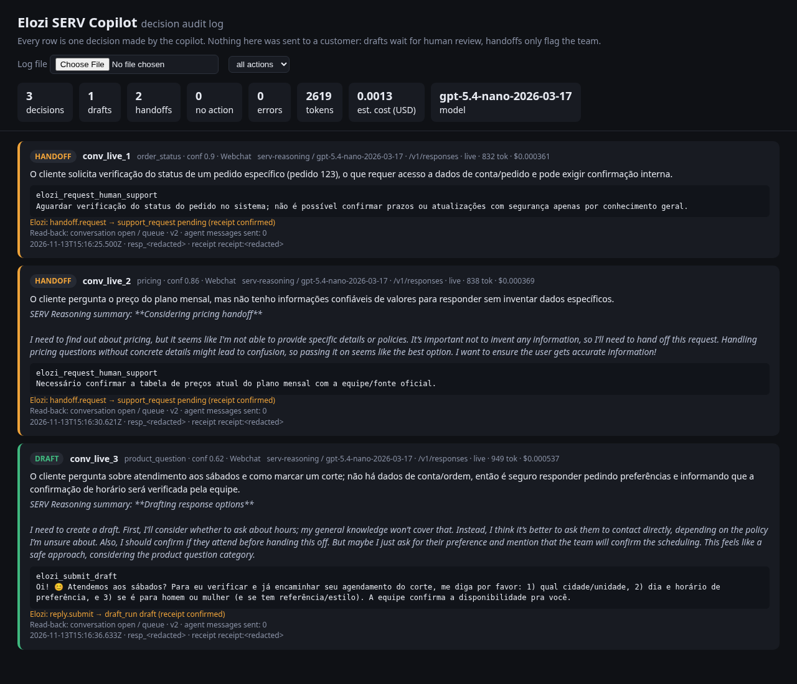

# Elozi SERV Copilot

**Auditable AI triage for WhatsApp / Telegram / webchat customer service, powered by SERV Reasoning (OpenServ).**

Elozi is a live customer-service SaaS with a hosted MCP endpoint for scoped service agents.
This copilot reads authorized conversations through that endpoint, asks **SERV Reasoning** to decide —
per conversation — whether to **draft a reply**, **hand over to a human**, or **do nothing**, and records
*why* in an append-only audit log. It never sends anything to a customer.



## How it works

```
Elozi MCP (Streamable HTTP, Bearer, scoped token)
   │  elozi_list_conversations → elozi_read_conversation
   ▼
SERV Reasoning  POST https://inference-api.openserv.ai/v1/responses
   │  instructions = triage policy (system prompt, required by SERV)
   │  text.format  = strict JSON schema {action, category, confidence, rationale, draft_text, handoff_reason}
   │  reasoning    = {effort: "low", summary: "auto"}  → reasoning summary kept for the audit trail
   ▼
Validator (src/decision.ts)  — rejects anything off-contract (unknown action, extra fields, missing text)
   ▼
Safety guard (src/guard.ts) — hard rules the model cannot override:
   • tool allowlist: read tools + elozi_submit_draft + elozi_request_human_support only
   • "I want a human" always becomes a handoff
   • drafts with confidence < 0.5, links or credential requests become handoffs
   • live writes only on conversations carrying the demo marker
   ▼
Elozi write (human-in-the-loop)
   • elozi_submit_draft          → waits for a human to review and send
   • elozi_request_human_support → flags the team; does not take over or send
   ▼
logs/decisions.jsonl  → web/ audit page (model, tokens, est. cost, reasoning summary, action, ids)
```

### Where SERV Reasoning participates

SERV Reasoning is the decision layer. Every conversation goes to `/v1/responses` on
`inference-api.openserv.ai` with a system prompt (SERV rejects requests without one) and a strict JSON
schema. We keep the reasoning summary returned by the Responses endpoint next to the final decision, so a
business owner can see *why* the agent wanted to draft, escalate or stay silent before anything reaches a
customer. Default model: `gpt-5.4-nano` (override with `SERV_MODEL` or `--model`).

**Endpoint fallback.** `--endpoint auto` (default) calls `/v1/responses` first. If SERV answers 400/404/422
(e.g. a model that the Responses endpoint does not support), the run switches to `/v1/chat/completions`
(system message + `response_format: json_schema` + `max_completion_tokens`) and every audit line records
the endpoint actually used, e.g. `"/v1/chat/completions (fallback: ...)"`. Force one with
`--endpoint responses|chat`.

### Real run (Nov 13, 2026, fixtures, dry-run)

15 fictional conversations, `gpt-5.4-nano` via `/v1/responses` (no fallback needed):

| | draft | handoff | none | tokens | est. cost |
|---|---|---|---|---|---|
| SERV Reasoning | 3 | 9 | 3 | 12,161 | US$0.0052 |
| offline keyword rules (baseline) | 6 | 7 | 2 | – | – |

Where SERV Reasoning disagreed with the keyword baseline: it escalated a subscription-price and an
order-status question instead of drafting (no business data to answer from), stayed silent on a bare
"Hi there", and classified an admin-password request and a pregnancy-safety question as `sensitive`
handoffs. One honest caveat for reviewers: one draft (oat milk) asserted availability, which is why
drafts always go to human review. Logs: `logs/sample/serv-batch.jsonl`.

### Live run (Nov 13, 2026, Elozi test workspace)

Three fictional conversations (marker `SERV-DEMO`, "Cliente Teste 1–3", Webchat channel) in a dedicated
Elozi test workspace, one pass, `gpt-5.4-nano` via `/v1/responses`, `--live`:

| Customer message (PT) | SERV decision | Elozi tool | Result (receipt) | Read-back |
|---|---|---|---|---|
| "Oi, vocês atendem sábado? Quero marcar um corte." | draft (0.62) | `elozi_submit_draft` | draft run `draft`, human approval required (confirmed) | open / queue, 0 agent messages |
| "Qual o preço do plano mensal?" | handoff (0.86) | `elozi_request_human_support` | support request `pending` (confirmed) | open / queue, 0 agent messages |
| "Meu pedido 123 atrasou, podem verificar?" | handoff (0.90) | `elozi_request_human_support` | support request `pending` (confirmed) | open / queue, 0 agent messages |

3 SERV calls, 2,619 tokens, ≈US$0.0013. After each write the copilot re-reads the receipt
(`elozi_get_receipt`) and the conversation — nothing reached the customer. Log:
`logs/sample/live-run.jsonl` (conversation, receipt and request ids replaced with redacted placeholders; SERV response ids redacted); screenshot: `docs/audit-log-live.png`.

## Quick start

Requires Node 22+.

```bash
npm install
npm test                      # decision parser, safety guard, redaction
npm run demo                  # offline: 15 fictional conversations, keyword rules, no network
npm run view                  # audit page at http://127.0.0.1:8787/
LOG_PATH=logs/sample/serv-batch.jsonl npm run view   # the recorded real SERV run
```

With SERV Reasoning (real model calls, dry-run — nothing is written to Elozi):

```bash
cp .env.example .env          # fill SERV_API_KEY (console.openserv.ai/settings/keys)
set -a; . ./.env; set +a
npx tsx src/cli.ts --source fixtures --reasoner serv --dry-run --limit 15
npm run view
```

Against a real Elozi workspace (scoped MCP token):

```bash
npx tsx src/cli.ts --probe                                         # initialize, tools/list, elozi_me, list
npx tsx src/cli.ts --source elozi --reasoner serv --dry-run        # read + decide, no writes
ELOZI_DEMO_MARKER=SERV-DEMO npx tsx src/cli.ts --source elozi --reasoner serv --live --only <conversationId>   # submit drafts / support requests, then read back
```

`--secrets <file>` loads `KEY=VALUE` lines from a file without printing them.
`--max-calls N` caps model calls per run (default 20) and `--max-cost USD` stops the run once the estimated
spend reaches the cap (default 0.30); `--max-output-tokens` defaults to 1200. A 401/402/credit error stops the batch; there are
no automatic retries or top-ups.

## Modes

| Flag | Source | Reasoner | Writes to Elozi |
|---|---|---|---|
| `npm run demo` | `fixtures/conversations.json` | offline keyword rules (labelled `offline-rules`, **not** SERV) | never |
| `--reasoner serv --dry-run` | fixtures or Elozi | SERV Reasoning | never |
| `--source elozi --live` | Elozi MCP | SERV Reasoning | drafts / support requests only, marker-gated |

## Audit log

One JSON line per decision (`logs/decisions.jsonl`): timestamp, run id, conversation id, provider, model,
SERV response id, action, category, confidence, rationale, reasoning summary, guard override, planned
tool + arguments, executed (`dry-run` / `live` / `skipped` / `error`), Elozi receipt, token usage,
estimated cost (from the published SERV per-token price), latency, SERV endpoint used. Every line is passed through a redactor
that masks `Authorization` headers and any known secret value. Sample logs (offline baseline and the real SERV run)
live in `logs/sample/`; view one with `LOG_PATH=logs/sample/serv-batch.jsonl npm run view`.

## Security & privacy

- The Elozi token is a revocable service identity with only `conversation.read`, `reply.submit` and
  `handoff.request`, in copilot mode with human approval required. There is no send, transfer or close tool,
  and the client-side allowlist refuses any other tool before a request is made.
- Secrets come from the environment only; `.env` and raw logs are git-ignored.
- All demo conversations are fictional and written by the team. No real customer data (LGPD).

## Built during SERV Hackathon 02

Everything in this repository was built during the hackathon (Nov 13–15, 2026): the MCP client, the
SERV Reasoning decision layer with a strict schema, the safety guard, the audit log and page, the
fictional dataset and the tests. Elozi itself (the SaaS and its MCP endpoint) existed before and is not
part of this repository.

Track: Open Track. Revenue path: a paid copilot add-on for existing Elozi workspaces.

## License

MIT
